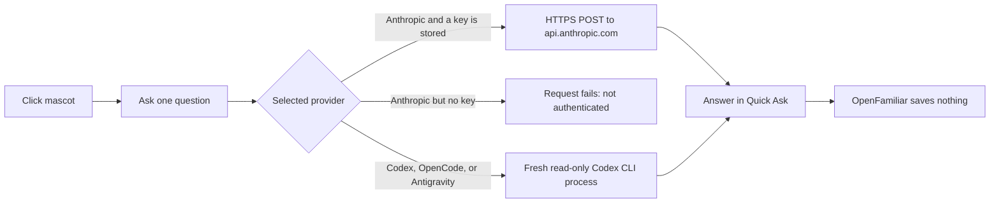

<p align="center">
  
</p>

<h1 align="center">OpenFamiliar</h1>

<p align="center"><strong>Ask once. Get an answer. OpenFamiliar does not keep it.</strong></p>

<p align="center">A pixel-art desktop buddy for your Codex CLI.</p>

<p align="center">No saved chat history, no OpenFamiliar account, no OpenFamiliar telemetry.</p>

<p align="center">
  
</p>

<p align="center">
  <a href="https://github.com/p3rformative/openfamiliar/blob/main/LICENSE"></a>
  <a href="https://github.com/p3rformative/openfamiliar/actions/workflows/ci.yml"></a>
  <a href="https://github.com/p3rformative/openfamiliar/releases"></a>
</p>

<p align="center">Windows 11 x64 only for now. The public beta installers are unsigned;
<a href="#unsigned-installer-heres-how-to-verify">here's how to verify</a>.</p>

> OpenFamiliar is an independent open-source project and is not affiliated with,
> sponsored by, or endorsed by OpenAI, Google, xAI, Anthropic, Microsoft, Amazon,
> or their respective products.

## What it is

OpenFamiliar is a local-first Windows desktop companion: Perrito Tech, a
transparent always-on-top pixel-art mascot, and a Quick Ask window for one
independent question at a time. You get an answer, and OpenFamiliar does not
keep a conversation history.

Quick Ask answers through the Codex CLI you already installed and signed in, or
through Anthropic if you select it in Settings and a key is stored. If you
select Anthropic without a key, the request fails as not authenticated and does
not fall back to Codex CLI. OpenFamiliar does not read Codex auth storage.
The published v0.1.0 installer answers only through Codex CLI; this Anthropic
path is in builds newer than that release.

**Built for:** people who already use Codex CLI and want a quiet desktop way to
ask one question; operators who want a local-first companion with no
OpenFamiliar account, cloud backend, or telemetry; and contributors who build
or validate familiar packs with `mascot-sdk`.

## Features

- One-shot questions: the prompt and answer stay in memory only for that
  request. OpenFamiliar does not save them.
- Static idle; animation runs only for explicit events. Teal (default),
  midnight, and burgundy accent palettes.
- Settings, tray, click-through recovery, preferences, and monitor-safe window
  position. Timeout is supported on both answer paths. Cancel stops the Codex
  CLI process tree; it does not cancel an in-flight Anthropic HTTPS request.
- Optional provider keys, if you add one in Settings, are stored in the OS
  keychain, never in `preferences.json` or logs.
- OpenCode and Antigravity can be selected in Settings, but they do not answer
  yet; in that case the question still goes through Codex CLI.
- No generic shell, no user-supplied CLI arguments, no telemetry, and no
  OpenFamiliar cloud backend.

The public `v0.1.0` installer answers only through Codex CLI. Builds newer than
that release can also answer through Anthropic if you select it in Settings and
a key is stored.

## Quick start

### Install on Windows

1. Download the official `v0.1.0` public beta only from [GitHub Releases](https://github.com/p3rformative/openfamiliar/releases/tag/v0.1.0). Do not download OpenFamiliar binaries from third-party sites.
2. Verify the unsigned installer (checksum and attestation below), then install.
3. Start OpenFamiliar, click Perrito Tech, and ask one question. The published `v0.1.0` installer answers only through Codex CLI, which must be installed and authenticated on the same machine. Builds newer than that release can also answer through Anthropic if you select it in Settings and a key is stored in the OS keychain.

<p id="unsigned-installer-heres-how-to-verify"></p>

<details>
<summary>Unsigned installer, here's how to verify</summary>

The `v0.1.0` public beta is unsigned, so Windows may display a SmartScreen warning.
Download the installers and `SHA256SUMS.txt` from the [v0.1.0 Releases page](https://github.com/p3rformative/openfamiliar/releases/tag/v0.1.0).
The release assets are `OpenFamiliar_0.1.0_x64-setup.exe`,
`OpenFamiliar_0.1.0_x64_en-US.msi`, and
[`SHA256SUMS.txt`](https://github.com/p3rformative/openfamiliar/releases/download/v0.1.0/SHA256SUMS.txt).

This repository was renamed from `georgiegozz/openfamiliar` to
`p3rformative/openfamiliar`. The v0.1.0 NSIS `.exe` and `.msi` were attested
under the old repository name. `SHA256SUMS.txt` was not attested; checking a
file against that list only confirms integrity, not provenance.

Compare each installer hash to `SHA256SUMS.txt`, then verify provenance with
the repository that issued the attestation:

```powershell
$exe = "OpenFamiliar_0.1.0_x64-setup.exe"
$msi = "OpenFamiliar_0.1.0_x64_en-US.msi"

foreach ($name in @($exe, $msi)) {
  $actual = (Get-FileHash $name -Algorithm SHA256).Hash
  $line = Get-Content .\SHA256SUMS.txt |
    Where-Object { $_ -match [regex]::Escape($name) }
  $expected = ($line -split '\s+')[0]
  if ($expected -and ($actual -ieq $expected)) {
    Write-Output "OK  $name"
  } else {
    throw "Hash mismatch or missing SHA256SUMS.txt line for $name"
  }
}

gh attestation verify $exe --repo georgiegozz/openfamiliar
gh attestation verify $msi --repo georgiegozz/openfamiliar
```

Use `--repo p3rformative/openfamiliar` for artifacts attested after the
rename. For the v0.1.0 installers, `--repo p3rformative/openfamiliar` does
not verify.

Unsigned does not mean unverified: install only when both the repository and
artifact are trusted.

</details>

### Build from source (PowerShell)

From [CONTRIBUTING.md](./CONTRIBUTING.md): Windows 11 x64, Node.js 20+, pnpm
9.15.0, Rust 1.88+ with `rustfmt` and `clippy`, Python 3.12 for mascot asset
checks, Visual Studio Build Tools 2022 (Desktop development with C++),
WebView2 Runtime, and Codex CLI installed and authenticated for real Quick Ask
use.

```powershell
# Run from the repository root.
corepack enable
corepack prepare pnpm@9.15.0 --activate
pnpm install --frozen-lockfile
py -3.12 -m venv .venv
.\.venv\Scripts\python.exe -m pip install -r .\scripts\assets\requirements.txt
rustup component add rustfmt clippy
pnpm --filter @openfamiliar/desktop tauri dev
```

Browser-only UI preview uses a non-network mock and cannot invoke Codex:

```powershell
pnpm --filter @openfamiliar/desktop dev
```

Unsigned MSI and NSIS installers:

```powershell
pnpm --filter @openfamiliar/desktop tauri build
```

Artifacts are written under `target/release/bundle/`. Validation commands and
the full Windows toolchain notes are in [CONTRIBUTING.md](./CONTRIBUTING.md)
and [docs/development/verification.md](./docs/development/verification.md).

## Screenshots

<p align="center">
  
  
  
  <br>
  <sub>Teal (default), midnight, and burgundy accent palettes. He stays put until you ask—no pacing, no side-eye.</sub>
</p>

The Quick Ask still at the top of this page is
`docs/assets/openfamiliar-quick-ask.png`.

## How it works

You click the mascot, type one question, and the answer appears in Quick Ask.
If Codex CLI is selected, OpenFamiliar starts a fresh read-only Codex CLI
process; the prompt and answer stay in memory only for that request, and the
process then exits. OpenFamiliar does not save the question or the answer.
When the answer goes through Codex CLI, Codex CLI sends your question to its
provider under its own terms; OpenFamiliar does not control what they retain.
Optional provider keys, if you add one in Settings, are stored in the OS
keychain, never in `preferences.json` or logs. Newer builds than v0.1.0 can
also answer through Anthropic if you select it and a key is stored.

If you select Anthropic in Settings and a key is stored in the OS keychain,
the desktop Rust process (not the webview) sends an HTTPS POST to
`https://api.anthropic.com/v1/messages`. If you select Anthropic and no key is
stored, the request fails as not authenticated and does not go through Codex
CLI. No request is started by idle animation, startup, palette selection, or
mascot movement.



See the [privacy policy](./PRIVACY.md) for the full one-shot and network
description.

## Security and privacy

- No generic shell command or user-supplied CLI arguments.
- When answering through Codex CLI: fresh ephemeral, read-only process per question.
- Prompt input and output size limits, and timeout. When answering through Codex CLI: cancellation and process-tree kill.
- Restrictive Tauri CSP and minimum capability allowlist.
- No auth/session scraping, `.env` runtime loading, loopback listener, MCP, or remote UI.
- No prompt, answer, credential, token, or raw process output in logs.

See the [privacy policy](./PRIVACY.md), [SECURITY.md](./SECURITY.md),
[ADR-009](./docs/adr/ADR-009-windows-one-shot-mvp.md), and the
[security boundary playbook](./docs/agent-playbooks/security-boundaries.md).

## Roadmap

The Windows 11 x64 desktop, Perrito Tech sprites (CC BY 4.0), static idle with
event-only animation, Settings, tray, and unsigned MSI/NSIS installers are
implemented, as listed in [ROADMAP.md](./ROADMAP.md). A clean-user smoke test
has been recorded on a separate Windows computer; see [ROADMAP.md](./ROADMAP.md) for remaining operator validation.

OpenCode and Antigravity one-shot paths are still planned. Code signing remains
a documented release gate; current public installers are unsigned. macOS and
Linux desktop ports are deferred, with no target date.

Other modules in the repo (workspace context, agent mode, MCP, the VS Code
extension, and Creator Studio) are experimental or scaffold only and are not
part of the stable Windows desktop.

## Docs

- [Privacy policy](./PRIVACY.md)
- [Security policy](./SECURITY.md)
- [Contributing](./CONTRIBUTING.md)
- [Roadmap](./ROADMAP.md)
- [Architecture overview](./docs/architecture/overview.md)
- [ADRs](./docs/adr/README.md)
- [Guides](./docs/guides/)
- [Support](./SUPPORT.md)

Pack types live in [`packages/mascot-sdk`](./packages/mascot-sdk). Questions
and patches go through
[Issues](https://github.com/p3rformative/openfamiliar/issues)
and pull requests. Look for issues labeled
[good first issue](https://github.com/p3rformative/openfamiliar/issues?q=is%3Aissue+is%3Aopen+label%3A%22good+first+issue%22)
if you want a starter task.

## License

- Code: [Apache License 2.0](./LICENSE)
- Perrito Tech artwork: CC BY 4.0, credited as “Perrito Tech — OpenFamiliar contributors”; see the [asset notice](./mascots/perrito-tech/NOTICE)
- Blank templates: CC0-1.0

See [NOTICE](./NOTICE) and [THIRD_PARTY_NOTICES.md](./THIRD_PARTY_NOTICES.md).
